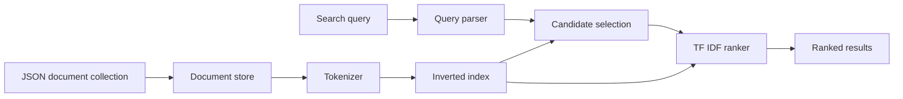

# Search Engine

[](https://github.com/MugdhoAI/search-engine/actions/workflows/ci.yml)

A small search engine built from scratch in Python. It demonstrates the core information retrieval pipeline: tokenization, inverted indexing, Boolean and phrase queries, TF IDF ranking, and JSON document storage.

The implementation is intentionally compact enough to follow from source documents to ranked results without relying on an external search engine library.

## What it does



An inverted index maps each term to the documents that contain it, along with its term frequency. This avoids scanning every document just to find candidate matches.

The included corpus supports queries such as:

```text
python
python AND search
python OR language
"search systems"
```

## Features

- Text tokenization and normalization
- Stop word filtering
- Inverted index with term frequencies and document lengths
- AND and OR queries
- Quoted phrase queries
- TF IDF relevance scoring
- Deterministic result ordering
- JSON persistence that rebuilds the index from source documents
- Command line interface
- Unit, persistence, query, ranking, and CLI integration tests
- Continuous integration on Python 3.11, 3.12, 3.13, and 3.14

## Quick start

Create a virtual environment:

```bash
python -m venv .venv
```

Activate it using the command for your shell.

macOS or Linux:

```bash
source .venv/bin/activate
```

Windows PowerShell:

```powershell
.venv\Scripts\Activate.ps1
```

Install the project and development tools:

```bash
python -m pip install -e ".[dev]"
```

Run the test suite and lint check:

```bash
python -m pytest
python -m ruff check src tests
```

Search the included collection:

```bash
search-engine examples/documents.json "python"
```

Example output:

```text
0.251804    1    Python is a programming language designed for readable software.
0.251804    4    Python can be used to build search systems.
```

The columns are score, document ID, and document text. Equal scores are ordered by ascending document ID. You can also run the CLI as a module:

```bash
python -m search_engine.cli examples/documents.json "python AND search"
```

## Query behavior

- Bare terms use OR semantics by default.
- `AND` requires all query terms to match; `OR` accepts matches from either side.
- Mixing `AND` and `OR` in the same query is rejected.
- Quoted phrases must appear as adjacent tokens after tokenization and stop word filtering.
- A phrase combined with unquoted terms uses AND semantics unless you explicitly use `OR`.

Phrase matching filters candidate documents. Results are ranked using the query terms, not phrase proximity or a learned relevance model.

## Architecture

The modules have distinct responsibilities:

- `document.py` defines the document record and validates its fields.
- `tokenizer.py` normalizes text into searchable terms and removes stop words.
- `index.py` builds the inverted index and stores term frequencies and document lengths.
- `query.py` parses Boolean and phrase queries and selects candidate documents.
- `ranking.py` calculates TF IDF scores and orders results deterministically.
- `engine.py` coordinates indexing, querying, and ranking through the public API.
- `storage.py` persists source documents as JSON and rebuilds the index when loading.
- `cli.py` exposes search through the command line.

The implementation uses Python dictionaries and sets so the retrieval structures remain visible rather than hidden behind a search framework.

For each unique query term present in a document, the ranker adds:

```text
(term frequency / searchable document length)
    * (log((number of documents + 1) / (document frequency + 1)) + 1)
```

Results are sorted by descending score and then ascending document ID. Deduplicating query terms prevents repeated words from artificially increasing a document's score.

## Validation

The tests cover tokenization, index construction, duplicate IDs, document lengths, ranked retrieval, Boolean and phrase queries, empty queries, invalid input, JSON persistence, deterministic ties, repeated query terms, and the CLI workflow.

CI installs the package, runs pytest, and checks the source and tests with Ruff on Python 3.11, 3.12, 3.13, and 3.14.

## Scope and limitations

This is an educational search engine, not a replacement for Lucene or Elasticsearch. Tokenization currently focuses on ASCII letters and digits, so multilingual text normalization is limited. Phrase matching operates on document text rather than a positional index, and the project has no benchmark results or claims about large-corpus performance.

Potential extensions include broader Unicode-aware tokenization, positional postings, reproducible benchmarks on a defined corpus, and experiments with larger collections.

## License

MIT
